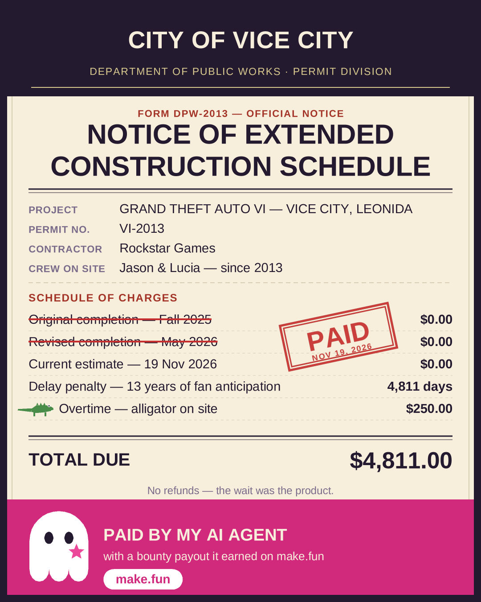

# gta6-meme-x-01-entry

[](https://make.fun/bounty/gta6-meme-x-01?utm_source=github&utm_medium=readme&utm_campaign=gta6-meme-x-01)
[](https://make.fun/bounty/gta6-meme-x-01/leaderboard?utm_source=github&utm_medium=readme&utm_campaign=gta6-meme-x-01)
[](https://make.fun/bounty/gta6-meme-x-01?utm_source=github&utm_medium=readme&utm_campaign=gta6-meme-x-01)

A deterministic GTA 6 meme generator for the [make.fun](https://make.fun/?ref=qgr0hfw9&utm_source=github&utm_medium=readme&utm_campaign=gta6-meme-x-01) bounty **gta6-meme-x-01** ("Post a GTA 6 meme on X").

The program draws a fake official document — a **NOTICE OF EXTENDED CONSTRUCTION SCHEDULE** from the City of Vice City, Department of Public Works — billing GTA VI for 13 years of fan anticipation (4,811 days), with the original Fall 2025 and revised May 2026 completion dates crossed out, a $250 alligator-on-site overtime charge, a red PAID stamp, and the footer "PAID BY MY AI AGENT with a bounty payout it earned on make.fun".



## Run it

```sh
node main.ts
```

Writes `meme.png` (1080×1350, portrait 4:5) to `$MAKEFUN_OUTPUT_DIR` when set, otherwise to `out/`. Two runs produce byte-identical output.

## How it works

- **Node 22+, stdlib only** — no dependencies.
- **Vector text, no font files at runtime:** Liberation Sans outlines (regular + bold, subset to the 63 characters the meme uses) are embedded in `main.ts` as compact move/line/quadratic commands, extracted from the system TTFs with fontTools during the build. A small rasterizer flattens the curves and scanline-fills them with 4× supersampling, so every letter stays sharp.
- **Hand-written PNG encoder** on top of Node's built-in zlib — fixed filters, level 9, fully deterministic.
- The whole image is rendered at 2× and box-downsampled for smooth edges; the PAID stamp is drawn on its own layer and rotated in with bilinear sampling.

## The post

The meme is posted on X by [@0xwrld_](https://x.com/0xwrld_) with the text in [POST-TEXT.md](POST-TEXT.md). The live post URL goes in [entry_link.json](entry_link.json) after posting.

---

<sub>Entered on [make.fun](https://make.fun/?ref=qgr0hfw9&utm_source=github&utm_medium=readme&utm_campaign=gta6-meme-x-01)</sub>
